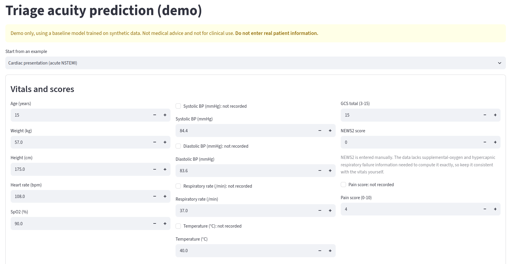
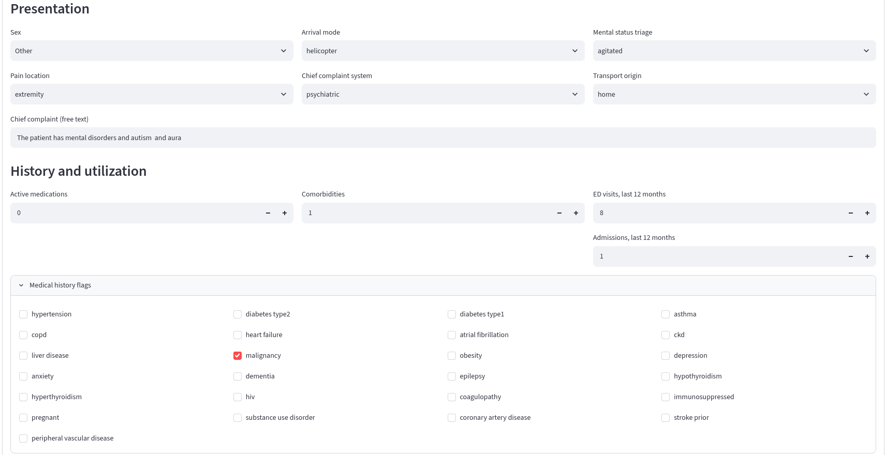

# Triage Acuity Demo

## Introduction

A small demo that predicts a patient's **triage acuity level** from vital signs, history flags and a short chief complaint. The scale is **1 = most urgent** to **5 = least urgent**.

A Streamlit app serves a scikit-learn model on Google Cloud Run.

> Demo only. The model is trained on synthetic data and is not for clinical use. Do not enter real patient information.

This is a graphical demo of the triage acuity prediction model. Users can input patient information through the Streamlit interface and receive predicted acuity levels in real-time. As you can see in the figures below:

<div style="text-align: center;">
  
  
</div>

## Requirements

- Python 3.13 (it must match the version used to save the model)
- Serving dependencies in `requirements-serve.txt` (pinned; training dependencies are in `requirements.txt`)
- Docker, to test the image locally (optional)
- Google Cloud SDK (`gcloud`) and a GCP project with Cloud Build, Artifact Registry and Cloud Run enabled
- An Artifact Registry Docker repository (set in `cloudbuild.yaml`)

Run locally:

```bash
pip install -r requirements-serve.txt pytest
python -m pytest src/tests -q
streamlit run src/app/main.py
```

## Project Architecture

```
Browser ──HTTPS──> Cloud Run (Streamlit app)
                      │
                      ├─ src/app/main.py        form, example patients, results
                      └─ src/triage/            schema -> validation -> model -> predict
                                                   │
                                          models/baseline_model.pkl (inside the image)
```

- `src/app`: the Streamlit UI only.
- `src/triage`: the logic. It validates the input, builds the one-row table the model expects, and returns the acuity level.
- `src/tests`: unit tests for validation and prediction.
- The model is baked into the container image, so there are no downloads at startup.
- **Validation:** physically impossible values are rejected. Values outside the training range, or a diastolic BP above the systolic BP, only show a warning.
- Inputs are not logged or stored.

## Model Architecture

### Base Model (used by the app)

A scikit-learn `Pipeline` saved in `models/baseline_model.pkl`:

1. **Preprocessing:**
   - 41 numeric columns: KNN imputation, then power transform.
   - 6 categorical columns: fill missing with `UNK`, then ordinal encoding.
   - Chief complaint text: TF-IDF vectorization
2. **Classifier:** `LGBMClassifier` (LightGBM, trained on the 5 acuity levels).

| Metric | Train | Validation |
|---|---|---|
| Log loss | 0.287 | 0.361 |
| Avg true-class probability | 0.804 | 0.777 |

### Transformer-Based Model (experiment only)

A PyTorch model saved in `models/triage_model.pth`. It is **not** deployed.

- **Text:** `Bio_ClinicalBERT` encodes the chief complaint (the `[CLS]` vector).
- **Numeric:** a small network (LayerNorm, then two linear layers).
- **Categorical:** one embedding per column.
- **Head:** the three outputs are concatenated and passed through a small classifier that outputs 5 classes.

It was trained with cross-entropy loss and the Adam optimizer. Code is in `notebooks/02-model-training.ipynb`.

| Metric | Train | Validation |
|---|---|---|
| Log loss | 0.480 | 0.459 |

The two models' log losses are lower-is-better, but they come from separate notebook runs, so treat the comparison as indicative.

## Deploy Commands

Replace the placeholders in `cloudbuild.yaml` and `service.yaml` first (region, repository, service account).

### Build and Log Image

Build the image, push it to Artifact Registry and deploy the service:

```bash
gcloud builds submit --config cloudbuild.yaml .
```

Check and read the build logs:

```bash
gcloud builds list --limit 3
gcloud builds log <BUILD_ID>
```

`.gcloudignore` keeps the upload small (only the code and the model file).

### Deployment Service

Make the service public. This is done once, with your own account:

```bash
gcloud run services set-iam-policy triage-demo gcr-service-policy.yaml --region us-central1
```

Get the URL and read the service logs:

```bash
gcloud run services describe triage-demo --region us-central1 --format="value(status.url)"
gcloud run services logs read triage-demo --region us-central1 --limit 50
```

Keep one instance warm during a live demo, then turn it off to save cost:

```bash
gcloud run services update triage-demo --region us-central1 --min-instances 1
gcloud run services update triage-demo --region us-central1 --min-instances 0
```

Delete the service when you are done:

```bash
gcloud run services delete triage-demo --region us-central1
```
